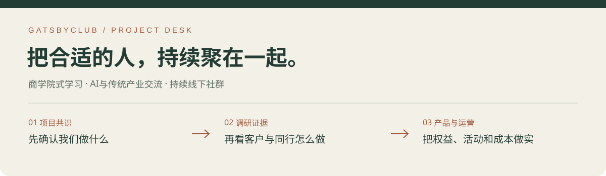

# GatsbyClub · 项目工作台

**以商学院式学习和AI产业交流作为前端的高端社群聚合平台。** 连接传统产业经营者与科技、AI创业人才；婚恋及高端旅游作为子品牌独立发展。

`项目共识：2026.11.09`　`综合调研：2026.10.24`　`启动初稿：2026.10.30`　`权益与收益：待定稿`

[项目基础](docs/项目定位与业务共识.md) · [最新成果](#最新成果) · [全部资料导航](docs/项目文件导航.md) · [当前待办](项目待办清单.md)

## 第一次来，从这里看

| 你现在想做什么 | 打开这里 |
| --- | --- |
| **了解我们做什么、服务谁** | **[项目定位与业务共识](docs/项目定位与业务共识.md)** |
| **发给合伙人，边看边讨论** | **[离线阅读资料包](outputs/gatsbyclub-research-site-20261024/交付文件/高端线下社群_离线阅读及附件.zip)**，含HTML、PDF、Excel和讲稿 |
| **查收费、客户、活动与证据** | [50页调研报告](outputs/integrated-research-20261024/交付文件/高端线下社群市场调研与对标报告.pdf) · [总Excel](outputs/integrated-research-20261024/交付文件/高端线下社群市场调研与对标总表.xlsx) |
| **继续推进项目** | [项目待办](项目待办清单.md) · [协作约定](AGENTS.md) |

> **最新会议存在待确认口径**：98,000元档新提3—5名额，与原6名额不同；暂保留原基线，见[会议冲突清单](docs/商业与生活方式协作会议整理_20261109.md)。

> **当前方向以基础文件为准。** 39,800元／3个名额、98,000元／6个名额已统一；具体权益、名额规则和收益条件仍待定。历史报告里的竞品报价、研究试价和本项目会籍价格分别使用。

## 最新成果

**业务结构已补全**：商业学习包括产业科技、企业经营、投资方法及参访游学；生活方式包括婚恋社交、高端旅游、医疗大健康、教育留学、移民及高端运动。[查看业务结构与各线状态](docs/项目定位与业务共识.md#当前业务结构)。具体供应、产品与权益待逐项确认。

**商业团队文案任务书已备好**：[宣导材料准备备忘录](docs/商业板块宣导材料准备备忘录_20261109.md)，可用于双方确认内容、分工和交稿日期，尚未发送。

**11月9日最新会议整理**：[商业与生活两板块、行动分工及待确认事项](docs/商业与生活方式协作会议整理_20261109.md)。近期先补商业宣导文字、核场地、重构收费，准备渠道见面会。实际会期与“两周内”起算日待确认。

**11月6日定位记录（结合本次更新使用）**：[变化、客户与近期工作](docs/学习型社群定位更新_20261106.md)。固定场地、宣导会和教授讲座尚未落实。当前先准备学习型平台介绍与首讲；下方10月30日初稿的定位文案、首场形式与权益数量需重审。

**10月30日启动初稿（需按新方向修订）**：[全套资料包](outputs/club-launch-drafts-20261030/交付文件/俱乐部启动初稿_全套资料.zip) · [19页工作方案](outputs/club-launch-drafts-20261030/交付文件/俱乐部启动工作方案.pdf) · [4表成本与薪酬Excel](outputs/club-launch-drafts-20261030/交付文件/俱乐部成本与薪酬测算.xlsx) · [16页企业PPT](outputs/club-launch-drafts-20261030/交付文件/俱乐部企业介绍与合作方案.pptx)。覆盖八项筹备工作，供合伙人修改；新增权益与成本均未定案。[范围与重要测算结果](outputs/club-launch-drafts-20261030/README.md)

| 材料 | 适合什么时候看 | 版本与状态 |
| --- | --- | --- |
| [调研报告 PDF](outputs/integrated-research-20261024/交付文件/高端线下社群市场调研与对标报告.pdf) | 系统了解市场与对标 | 2026.10.24 · 50页 |
| [研究总Excel](outputs/integrated-research-20261024/交付文件/高端线下社群市场调研与对标总表.xlsx) | 查产品、收费、客群与来源 | 2026.10.24 · 5张表 |
| [独立HTML文件](outputs/gatsbyclub-research-site-20261024/交付文件/高端线下社群市场调研与对标_直接打开.html) | 下载后用浏览器打开、放大图片 | 内容内嵌，无需登录 |
| [离线阅读资料包](outputs/gatsbyclub-research-site-20261024/交付文件/高端线下社群_离线阅读及附件.zip) | 一次发齐给合伙人 | HTML＋PDF＋Excel＋讲稿 |
| [启动产品与费用测算](outputs/execution-followthrough-20261024/交付文件/启动产品与费用测算.xlsx) | 比较人数、成本与现金情景 | 研究初案，输入待验证 |
| [口语讲解稿](outputs/execution-followthrough-20261024/交付文件/高端线下社群合伙人会议讲解稿.pdf) | 讲解调研结论 | 2026.10.24 · 5页 |

**手机阅读**：优先打开资料包里的PDF；HTML需下载后选择浏览器打开。在线网站仍保留为辅助入口，正式分享优先用文件。

## 资料按六类找

| ① 项目基础 | ② 市场调研 | ③ 产品与测算 |
| --- | --- | --- |
| [定位、客群、价格与待定项](docs/项目定位与业务共识.md) | [综合报告、总表和研究数据](docs/项目文件导航.md#02-市场调研与对标) | [权益框架、产品初案和成本模型](docs/项目文件导航.md#03-产品权益与测算) |

| ④ 阅读与汇报 | ⑤ 历史与专题 | ⑥ 工具与证据 |
| --- | --- | --- |
| [HTML、PDF、讲稿与资料包](docs/项目文件导航.md#04-阅读与汇报) | [旧报告、婚恋及马会等专题](docs/项目文件导航.md#05-历史与专题研究) | [来源、脚本及验收入口](docs/项目文件导航.md#06-工具来源与验收) |

## 现在还需要定什么

- [ ] 主平台首批产业端与技术端客户、学习需求和首讲主题。
- [ ] 固定场地、宣导会与讲者档期。
- [ ] 婚恋和旅游子品牌的负责人、产品与导流安排。

- [ ] 会员权益：每档包含什么，3个／6个名额如何使用。
- [ ] 合作收益：推荐、工作报酬及经营分配怎样计算。
- [ ] 首发活动：客户、主题、人数、流程、票价和成本。
- [ ] 客户与资源：真实付费反馈、供应商报价及可交付条件。

[查看完整待办 →](项目待办清单.md)

<strong>版本怎么看？技术资料在哪里？</strong>

- 项目方向看[基础文件](docs/项目定位与业务共识.md)，行业事实看原来源与日期。
- 旧文件不删除、不改名，避免破坏既有链接；已在[资料导航](docs/项目文件导航.md)中标清用途和版本。
- 网页下载副本、排版PDF和原成品可能相同，统一以本页入口为准，不重复判为新版本。
- 更多：[全部研究目录](outputs/README.md) · [版本维护规则](docs/版本与维护规则.md) · [工具](tools/README.md) · [归档与验收](archive/README.md) · [更新记录](CHANGELOG.md)。
- 10月27日整理成果已合并main；后续更新以相应PR状态为准。此前整理过程见[PR #7](https://github.com/3013038780-design/GatsbyClub/pull/7)。

---

更新于 **2026年11月9日** · 原始会议、个人资料、登录状态及具体股权结构不进入公开文件。
